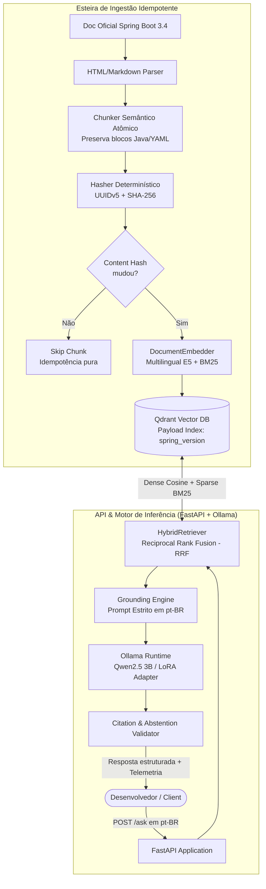

# SpringDocs Assistant

[](https://www.python.org/)
[](https://fastapi.tiangolo.com/)
[](https://qdrant.tech/)
[](https://ollama.ai/)
[](https://docs.pydantic.dev/)
[](https://www.docker.com/)
[](https://docs.astral.sh/uv/)
[](https://astral.sh/ruff)
[](https://docs.pytest.org/)
[](LICENSE)

Sistema de RAG Híbrido e alinhamento comportamental (Fine-Tuning QLoRA) construído sobre a documentação oficial do **Spring Boot 3.x**. Projetado para responder a dúvidas técnicas de engenharia de software com integridade sintática de código, citação estrita de fontes canônicas e abstenção segura em perguntas fora de escopo.

---

##  Visão Executiva: Separação de Responsabilidades

| Dimensão | Mecanismo | Responsabilidade Primária |
|:---|:---:|:---|
| **Conhecimento Técnico** | **RAG Híbrido (RRF)** | Injeta documentação oficial atualizada do Spring Boot 3.4 dinamicamente no contexto, eliminando alucinações factuais e referências a APIs legadas. |
| **Alinhamento Comportamental** | **Fine-Tuning QLoRA** | Treina o modelo para obedecer estritamente ao formato de citação `[Fonte: Título (URL)]`, responder em pt-BR técnico e acionar recusa segura imediata quando o contexto for insuficiente. |

---

##  Arquitetura da Solução

O sistema opera de forma desacoplada em duas esteiras: **Ingestão Idempotente** e **Recuperação e Geração (RAG)**.



---

##  Diferenciais de Engenharia

- **Pipeline RAG Explícito sem Abstrações Opacas**: Construído com clientes oficiais (`qdrant-client`, `httpx`, `fastembed`, `pydantic-settings`), sem frameworks caixa-preta como LangChain ou LlamaIndex ([ADR 001](docs/adr/001-pipeline-explicito-vs-langchain.md)).
- **Chunking Semântico com Preservação de Código**: Blocos delimitados (` ```java `, ` ```yaml `) são atômicos e indivisíveis. O overlap (10-15%) é restrito a parágrafos de texto corrido ([ADR 002](docs/adr/002-chunking-preservando-codigo-e-idempotencia.md)).
- **Idempotência Determinística via UUIDv5 + SHA-256**: IDs imutáveis baseados em `(spring_version + doc_url + section_title + chunk_index)`. Reindexações processam apenas chunks modificados, ignorando os idênticos em menos de **0.10s**.
- **Busca Híbrida Cross-Lingual**: Combina vetores densos (`intfloat/multilingual-e5-small`, 384 dim, Cosine) e esparsos léxicos (`Qdrant/bm25`), unificados via **Reciprocal Rank Fusion (RRF)** e filtrados por `spring_version: "3.4.0"`. Consultas em português recuperam documentação em inglês em **~35ms**.
- **Abstenção Confiável e Anti-Alucinação**: Se a documentação não responder à dúvida, o sistema não tenta adivinhar: ativa `abstained: true` e devolve recusa segura padronizada.

---

## Guia de Início Rápido (Quickstart)

### 1. Iniciar os Serviços via Docker Compose
Suba o banco vetorial **Qdrant**, o runtime **Ollama** e a **API FastAPI**:
```bash
docker compose up -d
```
- **Swagger UI**: [http://localhost:8000/docs](http://localhost:8000/docs)
- **Health Check**: [http://localhost:8000/health](http://localhost:8000/health)
- **Qdrant Dashboard**: [http://localhost:6333/dashboard](http://localhost:6333/dashboard)

### 2. Baixar o Modelo no Ollama
Faça o download do modelo base no container do Ollama:
```bash
docker compose exec ollama ollama pull qwen2.5:3b
```

### 3. Executar uma Pergunta Técnica
No Linux/macOS:
```bash
curl -s -X POST "http://localhost:8000/ask" \
  -H "Content-Type: application/json" \
  -d '{"question": "Como fazer uma requisição HTTP síncrona usando o RestClient no Spring Boot 3.4?"}'
```

No Windows PowerShell:
```powershell
Invoke-RestMethod -Uri "http://localhost:8000/ask" -Method Post `
  -ContentType "application/json; charset=utf-8" `
  -Body '{"question": "Como fazer uma requisição HTTP síncrona usando o RestClient no Spring Boot 3.4?"}' | ConvertTo-Json -Depth 5
```

---

##  Qualidade de Código e CI/CD

O projeto conta com uma esteira de automação no **GitHub Actions** ([`.github/workflows/ci-cd.yml`](.github/workflows/ci-cd.yml)) com **trava obrigatória de 80% de cobertura de código**:

1. **`ci-test-and-coverage`**: Executa linter (`ruff`) e suíte completa de testes com exportação do relatório para o `$GITHUB_STEP_SUMMARY`.
2. **`cd-docker-release`**: Build multi-stage da imagem Docker com cache de camadas e publicação automática no GitHub Container Registry (`ghcr.io`).

### Executando Localmente (Host ou Container)

Via `uv` no host:
```bash
# Análise estática com Ruff
uv run ruff check src/ tests/

# Testes unitários com enforcement de cobertura mínima de 80%
uv run pytest --cov=src --cov-report=term-missing --cov-fail-under=80
```

Diretamente dentro do container `api`:
```bash
docker compose exec api ruff check src/ tests/
docker compose exec api pytest --cov=src --cov-report=term-missing --cov-fail-under=80
```

---

##  Resultados e Métricas (Fase 1 - Baseline EXP-001)

Resultados consolidados a partir da execução do [scripts/smoke_test_phase1.py](scripts/smoke_test_phase1.py) (10 casos de teste):

| Métrica | Valor Obtido | Meta / Referência | Status |
|:---|:---:|:---:|:---:|
| **Taxa de Citação Correta (Factual)** | **87.5%** (7/8) | ≥ 80% | **Aprovado** |
| **Taxa de Abstenção Segura (Out-of-Scope)** | **100.0%** (2/2) | 100% | **Aprovado** |
| **Latência Média de Recuperação (Qdrant RRF)** | **35.58 ms** | < 200 ms | **Aprovado** |
| **Latência Média de Geração (Ollama CPU)** | **22.49 s** | N/A (CPU) | **Concluído** |
| **Cobertura de Testes Automatizados** | **87.67%** (54 testes) | ≥ 80% | **Aprovado** |
| **Reindexação Idempotente** | **~0.10 s** (23 ignorados) | Delta puro | **Aprovado** |

O histórico completo de testes e benchmarks está documentado em [docs/resultados.md](docs/resultados.md).

---

## 🔌 Exemplos de Uso da API

### 1. Pergunta Factual (`POST /ask`)
**Requisição:**
```json
{
  "question": "Como habilitar o suporte a Virtual Threads do Java 21 no Spring Boot 3.4 via application.yaml?",
  "top_k": 3
}
```

**Resposta:**
```json
{
  "answer": "Para habilitar o suporte a Virtual Threads no Spring Boot 3.4, adicione a propriedade no seu arquivo `application.yaml`:\n\n```yaml\nspring:\n  threads:\n    virtual:\n      enabled: true\n```\n\nQuando ativado, os servidores embutidos (Tomcat, Jetty) e métodos assíncronos passam a utilizar threads virtuais do Java 21.\n\n[Fonte: Enabling Virtual Threads (https://docs.spring.io/spring-boot/reference/features/spring-application.html#features.spring-application.virtual-threads)]",
  "abstained": false,
  "citations": [
    {
      "title": "Enabling Virtual Threads",
      "url": "https://docs.spring.io/spring-boot/reference/features/spring-application.html#features.spring-application.virtual-threads",
      "raw": "[Fonte: Enabling Virtual Threads (https://docs.spring.io/spring-boot/reference/features/spring-application.html#features.spring-application.virtual-threads)]"
    }
  ],
  "chunks_used": [
    {
      "chunk_id": "4b684cb3-00d9-5f21-93e1-dcb865fae74a",
      "section_title": "Core Features: Virtual Threads",
      "doc_url": "https://docs.spring.io/spring-boot/reference/features/spring-application.html#features.spring-application.virtual-threads",
      "score": 0.83333,
      "module": "core",
      "has_code": true,
      "text_preview": "Spring Boot 3.2+ and 3.4 provide first-class support for Virtual Threads (Project Loom)..."
    }
  ],
  "telemetry": {
    "retrieval_ms": 47.6,
    "generation_ms": 20380.0,
    "total_ms": 20427.43,
    "model": "qwen2.5:3b"
  }
}
```

### 2. Pergunta Fora de Escopo (`POST /ask` - Abstenção Segura)
**Requisição:**
```json
{
  "question": "Como configurar um cluster Kubernetes na AWS com Terraform?"
}
```

**Resposta:**
```json
{
  "answer": "Não encontrei informações suficientes na documentação oficial fornecida do Spring Boot 3.x para responder a esta pergunta.",
  "abstained": true,
  "citations": [],
  "chunks_used": [],
  "telemetry": {
    "retrieval_ms": 22.95,
    "generation_ms": 8510.0,
    "total_ms": 8533.83,
    "model": "qwen2.5:3b"
  }
}
```

### 3. Verificação de Saúde (`GET /health`)
```json
{
  "status": "ok",
  "qdrant": "connected",
  "ollama": "connected",
  "details": null
}
```

### 4. Ingestão Idempotente sob Demanda (`POST /ingest`)
```json
{
  "inserted": 0,
  "updated": 0,
  "skipped": 23,
  "total_chunks": 23,
  "duration_seconds": 0.069
}
```

---

##  Estrutura do Projeto

```text
springdocs-assistant/
├── .agents/
│   └── rules/                  # Regras arquiteturais e governança das personas de IA
├── .github/
│   └── workflows/
│       └── ci-cd.yml           # Pipeline GitHub Actions (Linter + Pytest >= 80% + GHCR)
├── data/
│   ├── processed/              # Chunks normalizados com hash determinístico (JSONL)
│   └── eval/                   # Dataset de avaliação isolado (Anti-Leakage)
├── docs/
│   ├── adr/                    # Architecture Decision Records (ADRs)
│   └── resultados.md           # Registro experimental com histórico de métricas
├── scripts/
│   └── smoke_test_phase1.py    # Suite de avaliação automatizada com 10 cenários
├── src/
│   ├── api/                    # Endpoints FastAPI, schemas Pydantic v2 e exception handlers
│   │   ├── main.py
│   │   └── schemas.py
│   ├── ingestion/              # Ingestão, parsing semântico, chunking atômico e indexer
│   │   ├── chunker.py
│   │   ├── curated_docs.py
│   │   ├── embedder.py
│   │   ├── fetcher.py
│   │   ├── hasher.py
│   │   ├── indexer.py
│   │   ├── models.py
│   │   ├── parser.py
│   │   └── pipeline.py
│   ├── rag/                    # Motor RAG híbrido, grounding prompt e cliente Ollama
│   │   ├── generator.py
│   │   ├── models.py
│   │   ├── prompt.py
│   │   ├── retriever.py
│   │   └── service.py
│   ├── config.py               # Configurações centralizadas via pydantic-settings
│   └── main.py                 # Re-export de entrada da aplicação FastAPI
├── tests/                      # 54 testes unitários automatizados com mocks (87.67% de cobertura)
├── docker-compose.yml          # Orquestração local: Qdrant, Ollama e FastAPI API
├── Dockerfile                  # Containerização otimizada com uv e dependências de dev
└── pyproject.toml              # Manifesto do projeto gerenciado pelo uv com travas de QA
```

---

##  Roadmap de Evolução

- [x] **Fase 1 — RAG Baseline & Engenharia de Dados**:
  - Parser semântico e chunker atômico com preservação de blocos Java e YAML.
  - Ingestão idempotente via UUIDv5 e SHA-256 no Qdrant.
  - Busca híbrida cross-lingual (Dense Multilingual E5 + Sparse BM25 via RRF).
  - API FastAPI com `/health`, `/ingest` e `/ask` com telemetria detalhada.
  - Pipeline de CI/CD no GitHub Actions com trava obrigatória de 80% de cobertura.
- [ ] **Fase 2 — Dataset de Alinhamento & Fine-Tuning QLoRA**:
  - Geração de dataset sintético ChatML com isolamento estrito contra `data/eval/`.
  - Treinamento QLoRA em 4-bit (Unsloth/TRL) focado em citação formal de fontes e abstenção ativa.
  - Exportação para formato GGUF e versionamento do `Modelfile` para o Ollama.
- [ ] **Fase 3 — Avaliação Sistemática e Benchmarks RAG (Ragas)**:
  - Avaliação de métricas de Context Recall, Faithfulness e Answer Relevancy.
  - Comparação A/B automatizada entre o modelo base (`qwen2.5:3b`) vs. fine-tuned.

---

## 📄 Licença

Este projeto é distribuído sob os termos da licença [Apache 2.0](LICENSE).
