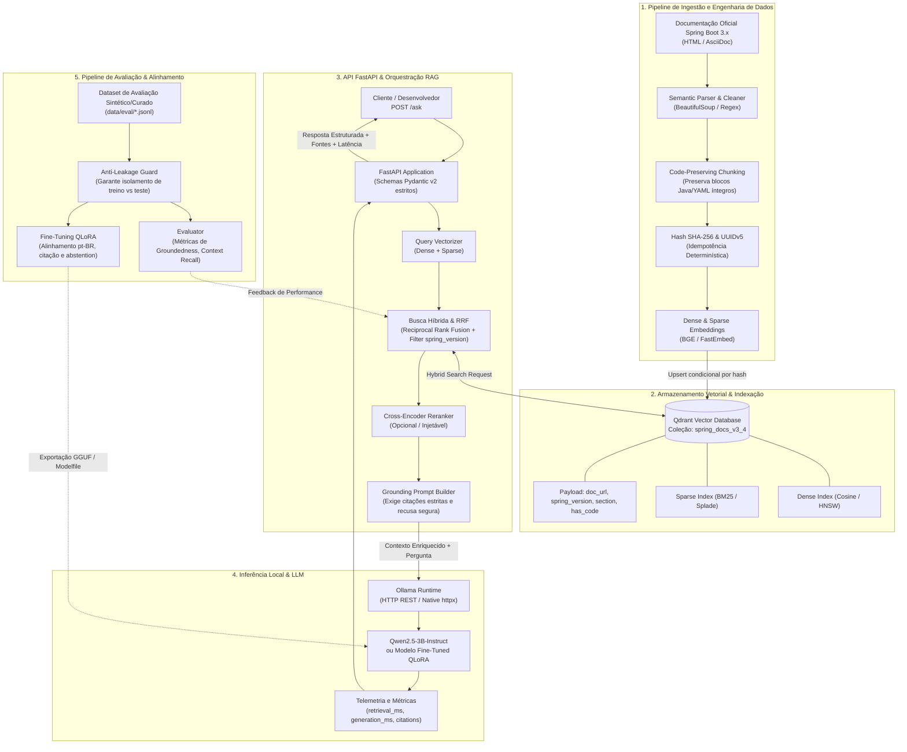

# Arquitetura do SpringDocs Assistant

## Visão Geral
O **SpringDocs Assistant** é uma solução de engenharia de software de ponta a ponta projetada para responder a dúvidas técnicas sobre o **Spring Boot 3.x** com precisão cirúrgica, citação estrita de fontes e código Java/YAML garantidamente íntegro.

A arquitetura elimina frameworks opacos (como LangChain), baseando-se em clientes nativos de alta performance, busca híbrida (Dense + Sparse) com Reciprocal Rank Fusion (RRF) no Qdrant, inferência local com Ollama (Qwen2.5-3B) e alinhamento comportamental via fine-tuning QLoRA.

---

## Diagrama da Arquitetura Geral

---

## Componentes Arquiteturais

### 1. Ingestão Idempotente e Preservação de Código
- **Preservação de Código**: Blocos delimitados de código Java e arquivos YAML jamais são fragmentados no meio. Se um bloco for maior que a janela alvo (350-500 tokens), o bloco permanece íntegro com a estratégia de agrupamento de nós pai-filho.
- **Idempotência**: Cada chunk possui um identificador UUIDv5 determinístico gerado a partir de:
  $$\text{UUIDv5}(\text{namespace}, \text{spring\_version} + \text{doc\_url} + \text{section\_title} + \text{chunk\_index})$$
  Acompanhado pelo `content_hash` (SHA-256), a reexecução do pipeline recalcula vetores apenas de conteúdos que realmente sofreram alteração.

### 2. Recuperação Híbrida (Dense + Sparse) com RRF
- **Busca Vetorial Híbrida**: O Qdrant combina busca densa (vetores semânticos com modelos BGE / Multilingual-E5) com busca esparsa (BM25 / Splade) para capturar tanto o significado semântico abstrato quanto termos léxicos exatos (ex: nomes de anotações `@ConditionalOnMissingBean`, propriedades `spring.datasource.hikari.*`).
- **Reciprocal Rank Fusion (RRF)**: Harmoniza os scores das buscas esparsa e densa de forma robusta e calibrável.
- **Filtros por Payload**: Todas as buscas filtram nativamente por `spring_version` para evitar misturar convenções legadas do Spring Boot 2.x com as atuais do 3.x.

### 3. API Resiliente e Sem Abstrações Opacas
- **FastAPI com Pydantic v2**: Toda a camada de API expõe contratos rigorosamente tipados.
- **Injeção de Hiperparâmetros**: Parâmetros como `top_k`, `score_threshold`, `rerank_enabled`, `temperature` e modelo de LLM podem ser customizados por chamada para permitir testes de regressão automatizados.
- **Telemetria Explícita**: O endpoint `/ask` responde com a discriminação exata de tempos de recuperação (`retrieval_latency_ms`) e de geração (`generation_latency_ms`), além da pontuação de similaridade e payloads dos chunks recuperados.

### 4. Fine-Tuning e Alinhamento Comportamental
- **Objetivo**: Não memorizar documentação, mas sim ensinar o modelo a:
  1. Responder no padrão técnico pt-BR com fluência natural;
  2. Preservar blocos de código com formatação impecável;
  3. Citar estritamente as fontes encontradas no formato `[Fonte: Título da Seção (URL)]`;
  4. Adotar política de **Abstention Segura** (recusar cordialmente quando a documentação recuperada não for suficiente para sanar a dúvida).
- **Anti-Leakage**: Nenhum chunk utilizado na geração de dados de treino ou validação pode colidir com as URLs reservadas no conjunto de teste em `data/eval/`.
